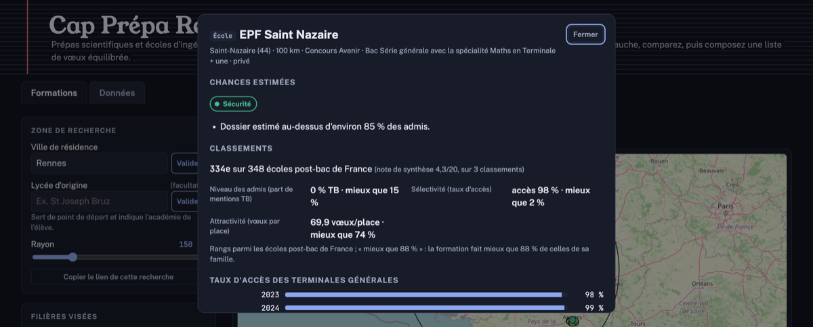

# Cap Prépa

Outil d'aide aux vœux Parcoursup pour un élève de **terminale générale** avec les spécialités **maths et
physique-chimie** (et l'option **maths expertes**), qui vise une **CPGE scientifique** (MPSI, MP2I, PCSI, PTSI,
BCPST) ou une **école d'ingénieurs post-bac** (prépa intégrée). Il s'appuie sur l'open data (Parcoursup, InserSup,
effectifs en CPGE, annuaire de l'éducation) et tourne en local, dans le navigateur : aucune donnée personnelle
(ville, notes, liste de vœux) n'en sort.

Hors périmètre pour l'instant : bacs technologiques (TSI, TB, TPC), prépas économiques et littéraires, autres
doublettes de spécialités.

<p>
  
  
  
</p>

## Ce qu'il permet

- partir de **sa ville de résidence ou de son lycée d'origine** (qui donne aussi l'académie de l'élève) et choisir
  un rayon de recherche ;
- filtrer par filière, public/privé, internat ;
- régler les notes de l'élève et voir un **score de dossier** par filière ;
- situer l'élève dans le **profil des admis** de chaque formation et obtenir une **estimation de chances** (de
  « Sécurité » à « Très ambitieux »), avec une fourchette quand un demi-point suffit à changer de catégorie, et les
  raisons de l'estimation ;
- une **carte** (OpenStreetMap, avec repli automatique sur une carte schématique sans connexion) et une **fiche
  détaillée** par formation (taux d'accès sur 3 sessions, profil des admis, internat, débouchés) ;
- **comparer** 2 à 4 formations côte à côte ;
- un **classement** de chaque formation parmi celles de sa famille (CPGE ou écoles), et une **note de synthèse**
  combinant plusieurs critères, dont les classements de presse qu'on y ajoute soi-même ;
- pour une prépa, les **écoles où ses élèves sont intégrés** après le concours, saisies à la main ou extraites
  automatiquement de la page de résultats du lycée ;
- composer une **liste de vœux**, avec les sous-vœux des concours communs et le choix de l'internat, vérifier
  qu'elle est équilibrée, l'imprimer ou la partager ;
- une utilisation **au clavier** et **hors connexion** après une première visite.

C'est une aide au tri, pas une prédiction d'admission : la méthode et ses limites sont détaillées en bas de la
page (rubrique « Méthode, sources et limites »).

## Installer et lancer l'outil

**macOS / Linux** :

```bash
./installer.sh   # une seule fois : vérifie Python 3.11+, télécharge les données
./lancer.command # ensuite : lance le serveur local et ouvre le navigateur
```

`lancer.command` peut aussi s'ouvrir d'un double-clic dans le Finder.

**Windows** : double-clic sur `installer.bat` (une seule fois), puis sur `lancer.bat`. Pour l'extraction
automatique des débouchés au format PDF, installer en plus `pdftotext` (paquet poppler) ; sans lui, la saisie
manuelle reste disponible.

Les deux lancent `scripts/serveur.py` (bibliothèque standard, n'écoute que sur `127.0.0.1`) sur
`http://127.0.0.1:8765`, qui sert le site **et** l'onglet « Données » : mise à jour des sources, import des
classements personnels, extraction des débouchés, recherche des liens vers les résultats des lycées. Sans ce
serveur, en servant les fichiers autrement (`python3 -m http.server`, GitHub Pages…), l'outil fonctionne pour
chercher des formations mais l'onglet « Données » explique qu'il manque le serveur local pour ses propres
fonctions.

**Premier lancement bloqué par le système** : macOS (Gatekeeper) et Windows (Defender) marquent les fichiers
téléchargés et bloquent leur premier lancement direct. C'est normal, pas un virus.
- macOS : message « Apple n'a pas pu confirmer... » sur `installer.sh` → clic droit → Ouvrir, une seule fois
  (ou lancer depuis le Terminal, qui n'est pas concerné). `installer.sh` retire ensuite ce même blocage sur
  `lancer.command`, qui n'a donc pas besoin d'un second déblocage.
- Windows : SmartScreen ou Defender peuvent signaler l'archive téléchargée depuis GitHub → « Informations
  complémentaires » puis « Exécuter quand même ».

## Choisir la ville ou le lycée de résidence

Plusieurs façons, de la plus prioritaire à la moins prioritaire :

1. **Dans l'adresse** : `index.html?ville=Rennes` ou `index.html?lycee=<UAI>` (l'identifiant d'un lycée, visible
   dans l'adresse donnée par le bouton « Copier le lien de cette recherche » une fois le lycée choisi).
   Autres paramètres : `rayon=200` (km, 25 à 600) et `filieres=MPSI,PCSI,ING`. Avec des coordonnées précises :
   `index.html?ville=Chez%20nous&lat=48.05&lon=-1.75`.
2. **Dans la page** : champ « Ville de résidence » (communes reconnues via `geo.api.gouv.fr`) ou « Lycée d'origine »
   (facultatif ; fixe aussi l'académie de l'élève, utilisée dans les raisons de l'estimation).
3. **Par défaut** : `villeParDefaut` dans `config.js`.

Le dernier choix est retenu dans le navigateur.

## Données

| Fichier | Rôle |
|---|---|
| `data/formations.json` | Une ligne par formation (CPGE et écoles post-bac), session Parcoursup la plus récente avec l'historique de 2 sessions, toute la France |
| `data/lycees.json` | Lycées proposés dans le champ « Lycée d'origine » (annuaire de l'éducation) |
| `data/liens-resultats.json` | Adresse de la page de résultats aux concours de chaque lycée à prépa, quand elle a été trouvée |
| `data/sources/` | Exports bruts des jeux de données (hors dépôt, régénérables) |
| `data/2026/` | Classements de presse transcrits à la main (voir plus bas) |

Pour régénérer `data/formations.json` et `data/lycees.json` :

```bash
python3 scripts/update_data.py            # télécharge puis reconstruit
python3 scripts/update_data.py --hors-ligne  # reconstruit depuis data/sources/, sans réseau
```

Le script ne dépend que de la bibliothèque standard de Python 3.11+. Depuis l'outil, l'onglet « Données » fait la
même chose formation par formation, avec la version locale et la version publiée de chaque source, et un bouton
pour mettre à jour. Le workflow `.github/workflows/update-data.yml` régénère aussi les données sur GitHub (lancement
manuel depuis l'onglet *Actions*, puis le 1ᵉʳ de chaque mois d'octobre à février) et propose le résultat en pull
request.

Sources, toutes en Licence Ouverte / Open Licence (Etalab) : [Parcoursup](https://data.enseignementsup-recherche.gouv.fr/explore/dataset/fr-esr-parcoursup/),
cartographie des formations (internat), propositions par doublette de spécialités, [InserSup](https://data.enseignementsup-recherche.gouv.fr/explore/dataset/fr-esr-insersup/)
(insertion des diplômés ingénieurs), effectifs en CPGE, [annuaire de l'éducation](https://data.education.gouv.fr/explore/dataset/fr-en-annuaire-education/)
(lycées et leur site).

## Classements, débouchés et liste de vœux

- **Classements** : chaque formation est rangée parmi celles de sa famille (CPGE ou écoles post-bac) selon le
  niveau des admis, la sélectivité, l'attractivité et, pour les écoles, l'emploi et le salaire des diplômés
  (InserSup). On peut y ajouter ses propres classements (palmarès de presse, par exemple) en important un CSV
  depuis l'onglet « Données » ; `data/2026/` contient des classements de L'Étudiant déjà transcrits (voir
  `data/2026/etudiant/SOURCES.md` pour leur origine et leurs limites), chargeables en un clic avec le bouton
  « Charger les CSV de data/ ».
- **Débouchés d'une prépa** : les écoles où ses élèves sont intégrés, saisies à la main (onglet « Données ») ou
  extraites automatiquement de la page de résultats du lycée (bouton dans la fiche de la prépa ; l'extraction
  est à vérifier avant d'enregistrer). `scripts/liens.py` explore les sites des lycées pour trouver cette page
  sans passer par un moteur de recherche (qui refuserait des requêtes automatiques).
- **Liste de vœux** : les écoles d'un même concours commun comptent pour un seul vœu avec leurs sous-vœux, une
  CPGE demandée avec et sans internat aussi ; impression ou export PDF, et un lien de partage qui garde les notes
  hors du serveur (dans la partie `#` de l'adresse, jamais envoyée).

## Organisation des fichiers

| Fichier | Rôle |
|---|---|
| `index.html` | Page et styles |
| `src/main.js` | Démarrage, état, rendu de la liste et des contrôles |
| `src/calc.js` | Calculs purs : score, chances, filtres, tri, liste de vœux (testé par `tests/calc.test.js`) |
| `src/classements.js` | Classements, centiles, note de synthèse, lecture des CSV |
| `src/debouches.js` | Résumé des débouchés saisis |
| `src/fiche.js`, `src/liste.js` | Fiche d'une formation, comparaison, liste de vœux et version imprimable |
| `src/carte.js`, `src/carte-osm.js` | Carte schématique (SVG) et carte OpenStreetMap |
| `src/geo.js` | Géocodage des villes |
| `src/donnees.js` | Onglet « Données » |
| `config.js` | Tous les réglages modifiables (ville, filières, poids, seuils…), chacun commenté |
| `scripts/update_data.py` | Téléchargement et construction de `data/formations.json` et `data/lycees.json` |
| `scripts/serveur.py` | Serveur local (`./lancer.command`) : sert le site et l'API de l'onglet « Données » |
| `scripts/debouches.py` | Extraction des écoles intégrées depuis une page de résultats |
| `scripts/liens.py` | Recherche des pages de résultats des lycées, sans moteur de recherche |
| `installer.sh`, `lancer.command` | Installation et lancement en local (macOS/Linux) |
| `installer.bat`, `lancer.bat` | Installation et lancement en local (Windows) |

### Ajuster les réglages

Toutes les clés lues par le code sont dans `config.js`, avec une phrase expliquant chacune : poids des critères de
classement, seuils des catégories de chances, poids des matières par filière, etc. Les poids par défaut (constante
`W` de `src/calc.js`) sont des hypothèses inspirées des critères affichés sur les fiches Parcoursup : aucune
formation ne publie de barème chiffré. Lisez toujours la rubrique « Critères généraux d'examen des vœux » de la
fiche officielle.

## Vérifications avant de contribuer

```bash
npm test             # node --test, logique JavaScript (src/*.js)
pytest -q tests       # scripts Python (scripts/*.py)
ruff check scripts tests
ruff format scripts tests
```

## Limites

- Parcoursup ne publie pas les admissions par lycée d'origine. L'académie de l'élève (via le lycée choisi) et la
  part d'admis de la même académie restent les seuls indicateurs de recrutement local.
- InserSup (emploi, salaire) ne couvre qu'environ un quart des écoles référencées : beaucoup sont trop récentes,
  trop petites, ou leurs diplômés sont comptés sous un autre établissement du même réseau.
- La base des liens vers les résultats des lycées (`data/liens-resultats.json`) reste partielle : un lien n'y est
  gardé que si l'extraction y reconnaît vraiment des écoles d'ingénieurs, ce qui écarte beaucoup de lycées qui
  publient leurs résultats sous une forme que l'outil ne sait pas lire, ou ne les publient pas du tout.
- Les classements de presse ne sont pas des données ouvertes : l'outil ne les récupère pas lui-même, on les
  importe à la main (voir `data/2026/etudiant/SOURCES.md` pour les limites propres aux fichiers déjà fournis).
- Pour les concours communs (Geipi Polytech, Puissance Alpha, Avenir, Advance), les chiffres valent souvent pour
  l'ensemble du concours, affichés sur chaque école du réseau.
